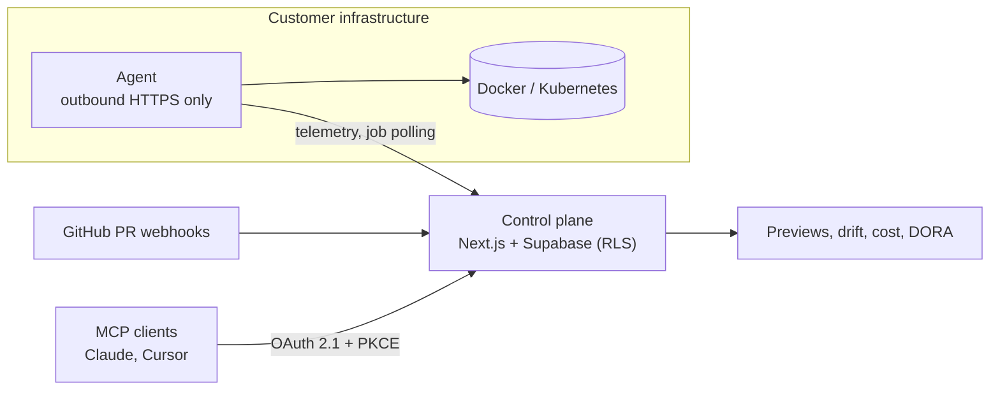
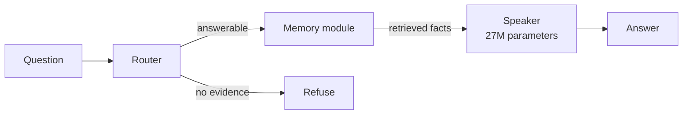

 

**[About](#about)** · **[Featured work](#featured-work)** · **[Also building](#also-building)** · **[Public repositories](#public-repositories)** · **[Stack](#stack)** · **[Connect](#connect)**

---

## About

I'm a third-semester Applied Software Engineering student at Telkom University in Bandung, and a solo developer building under KuroTech Lab. I build AI-agent tooling and a platform-engineering SaaS, and I train small models from scratch to understand exactly how they fail.

My rule is simple: **AI proposes; hard validation and a human decide**, and every claim comes with evidence I can show. I'm looking for an entry-level ML/AI engineering role, remote-friendly, where I can keep building end to end: data, models, backend and deployment.

| | |
|:--|:--|
| **Based in** | Bandung, Indonesia |
| **Studying** | D3 Applied Software Engineering (RPLA), Telkom University |
| **Building** | StrataCore, KirakuStore, independent AI research |
| **Looking for** | Entry-level ML/AI engineering roles, remote-friendly |
| **Best way to reach me** | [LinkedIn](https://www.linkedin.com/in/armandalfarizy) |

<table>
<tr>
<td width="33%" valign="top">

**Propose is not decide** 
A model never has the last word on a destructive action. A rule or a person does.

</td>
<td width="33%" valign="top">

**Evidence before claims** 
If a test, a log or a measurement can't back a sentence, the sentence gets smaller.

</td>
<td width="33%" valign="top">

**Fail closed** 
When something is unverified, unreachable or ambiguous, the system refuses instead of guessing.

</td>
</tr>
</table>

---

## Featured work

> [!NOTE]
> Some of this work lives in private repositories because it is product or research work. The write-ups below come from the code and docs, and I'm glad to walk through any of it in an interview. Click a project to expand it.

<b>StrataCore</b> · autonomous platform engineering · <a href="https://stratacore.dev">stratacore.dev</a>

 

<table>
<tr><td width="130"><b>What it is</b></td><td>A control plane that creates a preview environment for every pull request on servers the customer controls, and reports drift, spend, right-sizing and DORA metrics across services. Live at <a href="https://stratacore.dev">stratacore.dev</a>.</td></tr>
<tr><td><b>Approach</b></td><td>An outbound-only agent reads labelled Docker containers and runs jobs from the console, so customer infrastructure needs no open inbound port. It installs from one command, a Kubernetes manifest, a Helm chart or a Terraform module, with RBAC limited to labelled namespaces.</td></tr>
<tr><td><b>AI and MCP</b></td><td>A remote MCP endpoint (OAuth 2.1 with PKCE, scoped read, write and admin tokens) lets Claude or Cursor inspect and operate a workspace. Destructive actions refuse to run without <code>confirm=true</code>, secrets and billing are never exposed, and every change is audit-logged under the AI actor's token name.</td></tr>
<tr><td><b>Security</b></td><td>Row-level security on every tenant table, billing columns writable only by the service role, AES-256-GCM secrets, HMAC-peppered agent tokens, HMAC and replay-window checks on payment webhooks, and a per-request-nonce CSP.</td></tr>
<tr><td><b>Evidence</b></td><td>CI runs database/RLS tests, unit tests and Playwright end-to-end tests against a real Next.js server and a real local Postgres (no mocks for database, auth or internal APIs), plus agent tests on a real Kubernetes cluster (kind). The README lists what is <i>not</i> tested yet, such as live AI providers and live payments.</td></tr>
<tr><td><b>Stack</b></td><td>Next.js 15 · React 19 · Supabase (Postgres, Auth, Realtime) · Paddle Billing · Cloudflare Workers · Gemini with BYOK · Docker · Kubernetes · Helm · Terraform · GitHub Actions</td></tr>
</table>

The agent and deploy artifacts are open source (MIT): [stratacore-agent-examples](https://github.com/ArcVielLouvent/stratacore-agent-examples).

<b>Modular AI</b> · small models, built from zero · independent research

 

<table>
<tr><td width="130"><b>Question</b></td><td>Can a ~27M-parameter language model act as one small part of a larger system, with its knowledge supplied from outside instead of memorised? Independent research toward a modular AI product.</td></tr>
<tr><td><b>Approach</b></td><td>A decoder-only transformer (RMSNorm, RoPE, SwiGLU) trained from scratch on Indonesian Wikipedia with my own BPE tokenizer, then connected to a separate memory module that retrieves facts and a router that can refuse a question before it reaches the model. One variable changes per experiment, and every result is logged.</td></tr>
<tr><td><b>Stack</b></td><td>Python · PyTorch · Kaggle GPUs · BM25 retrieval · custom BPE tokenizer · bootstrap confidence intervals</td></tr>
</table>

**Selected results** (synthetic benchmark, memory store of 1,000 countries, two-step retrieval):

| Experiment | Exact match | What changed |
|:--|--:|:--|
| Baseline, facts retrieved but model not trained on retrieved context | 79.2% | Starting point |
| Fine-tuned on retrieved context | 95.7% | Train the way you test |
| Fine-tuned on store sizes up to 1,000 | **98.8%** | Fixed a distribution shift I diagnosed from error logs |
| Store of 1,500, never seen in training | **99.2%** | Generalises to a larger store |

Answers follow a replaced memory 99.0% of the time at 1,000 countries, and the model invented an answer to 0% of unanswerable questions there.

**What the experiments taught me**

- **Data diversity beat capacity.** Widening the name pool took one variant from 88.2% to 98.7% and cut name-copy errors by 97%, so the 27M model was not the limit.
- **I rejected my own hypothesis.** Shuffling fact order barely moved the score, so position bias was not the cause. The real cause was the model never having seen the context mix a large store produces.
- **I caught a flawed probe.** My first garbage-in test used strings the model had never seen, so its 0.0 proved nothing. I replaced it and said so in the notes.
- **Honest limits.** The benchmark is synthetic and word-matching retrieval is easy on it. The next step is paraphrase, typos and multi-hop questions that BM25 cannot handle.

<b>KirakuStore</b> · a library that keeps links, prompts and snippets healthy · <a href="https://kirakustore.com">kirakustore.com</a>

 

<table>
<tr><td width="130"><b>What it is</b></td><td>A library for links, prompts and snippets that keeps them healthy and ranks the best one first. Built by KuroTech Lab; <a href="https://kirakustore.com">kirakustore.com</a>.</td></tr>
<tr><td><b>Approach</b></td><td>The ranking-critical fields (<code>exp</code>, <code>hp</code>, <code>status</code>, <code>plan</code>) can only be changed by the database, never by the client. Row-level security covers every table, and SQL tests check RLS, plan limits and decay. Sessions live in HttpOnly cookies set on the server, so the browser never holds a token.</td></tr>
<tr><td><b>Surfaces</b></td><td>A Next.js web app, a <a href="https://github.com/ArcVielLouvent/kiraku-store-plugin">plugin</a>, a <a href="https://github.com/ArcVielLouvent/kiraku-store-extension">browser extension</a> and a remote MCP endpoint, so an assistant can reuse the best saved snippet before it writes new code.</td></tr>
<tr><td><b>Engineering</b></td><td>CI runs lint, typecheck, unit tests, a production build, a smoke test on the Workers runtime and Playwright on Chromium and Firefox, then deploys from <code>main</code>. Sign-in supports Google, GitHub, Azure and email OTP, with a 12-character minimum password.</td></tr>
<tr><td><b>Stack</b></td><td>Next.js · Supabase (Postgres, RLS) · Cloudflare Workers via OpenNext · Playwright · GitHub Actions · Model Context Protocol</td></tr>
</table>

---

## Also building

| Project | What it is | Status |
|:--|:--|:--|
| **Tenken** | QA for AI coding agents: execution evidence for every "done" claim, so only the doubtful ones reach a single human decision inbox. CLI plus web app, WCAG 2.1 AA checks, 90% line-coverage gate. | In development |
| **Yomira** | A multilingual reading and creator platform: rights-aware catalog, creator studio, community moderation and a fail-closed translation pipeline. Astro on Cloudflare Workers with Neon Postgres (73 tables, schema parity verified against code). | In development, not launched |

---

## Public repositories

| Repository | What it shows | Stack |
|:--|:--|:--|
| [**yomi-triage-system**](https://github.com/ArcVielLouvent/yomi-triage-system) | An incident-response engine that drives SANS SIFT forensic tools through a type-safe MCP server. The model is an untrusted reasoner, containment is gated by fixed rules, and each decision is sealed into a signed ledger. | Python · MCP · DFIR |
| [**tegata**](https://github.com/ArcVielLouvent/tegata) · [live demo](https://tegata-production.up.railway.app/) | Time-boxed privileged access: a risk-scored document, a human signature, live enforcement on every request and automatic expiry. Hash-chained audit log, 137-test agent suite and Playwright end-to-end tests. | TypeScript · Python · Xano |
| [**stratacore-agent-examples**](https://github.com/ArcVielLouvent/stratacore-agent-examples) | The outbound-only agent protocol from StrataCore, with runnable code. | MIT |
| [**kuro-sre-mcp**](https://github.com/ArcVielLouvent/kuro-sre-mcp) | Built for the DEV.to x Notion MCP Hackathon: an MCP server that lets an AI assistant diagnose incidents from Notion runbooks, with a rollback that needs human approval. The Notion workspace it used has since been deleted, so it is kept as a reference, not a runnable demo. | JavaScript · MCP |
| [**PJK-RM119-CareerMatch-AI**](https://github.com/ArcVielLouvent/PJK-RM119-CareerMatch-AI) | Capstone project that matches CV skills to job postings with TF-IDF. | Python · NLP |

<b>A lesson worth recording: Yomi</b>

 

Yomi was entered in the SANS Find Evil! hackathon and did not place. Its live containment design held up, but the project claimed more than it had tested. I rebuilt it with narrower claims and deeper test coverage; the plan and the per-phase log are in the repository.

I would rather publish a smaller claim I can prove.

---

## Stack

| Area | Tools |
|:--|:--|
| **ML and data** | PyTorch, transformers from scratch, BPE tokenizers, BM25 retrieval, TF-IDF, evaluation design |
| **AI agents** | Model Context Protocol servers and clients, tool-use design, human-in-the-loop gates, Gemini |
| **Backend** | Next.js, Node.js, Python, PostgreSQL, Supabase, row-level security, Xano |
| **Infrastructure** | Cloudflare Workers, Docker, GitHub Actions |
| **Quality** | Playwright, SQL tests for RLS, CI gates, axe accessibility checks |

---

## Connect

**The fastest way to reach me is LinkedIn.**

Questions about a public repository are welcome as GitHub issues or discussions.

